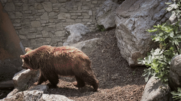
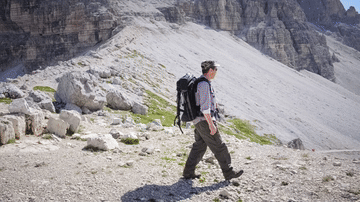
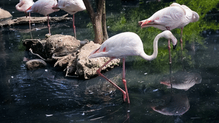
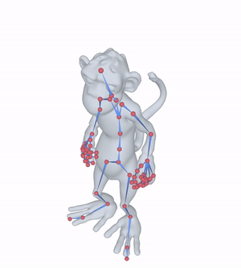
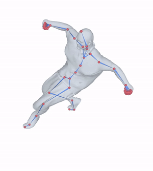
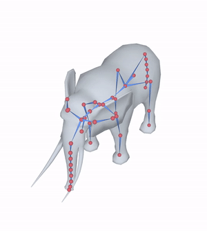
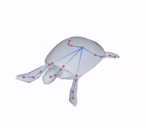
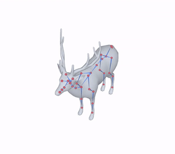
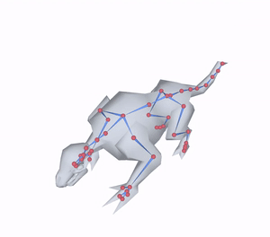

# FlowRig: Unified Skeleton Generation for 3D and 4D Meshes via Flow Matching

[Fengzhi Guo](https://percool.github.io/) &emsp; Nate Morrill &emsp; [Shiqi Li](https://shi-qi-li.github.io/) &emsp; [Cheng Zhang](https://czhang0528.github.io/)

Texas A&M University

<!-- TODO: the arXiv badge points to a placeholder until the paper is public -->

Automatic rigging is a fundamental task for both static 3D and dynamic 4D mesh animation. We propose **FlowRig**, a template-free and data-efficient framework for unified 3D and 4D skeleton generation. Built on flow matching, FlowRig generates temporally aligned skeletons for an entire sequence in a single feedforward pass, while naturally handling single-mesh 3D rigging. The model further supports explicit skeleton-count control, uncertainty estimation for candidate selection, and masking-based interpolation, forecasting, and backcasting.

<!-- GIFs from static/readme/, made by skt/mytool/export_readme_gifs.py in the main code repo -->
## In-the-Wild

Real [DAVIS](https://davischallenge.org/) videos lifted to 4D meshes by [ActionMesh](https://remysabathier.github.io/actionmesh/), rigged by FlowRig.

  
  
  

## Dynamic Reconstruction

Skeletons for animated meshes.

  
  
  

## Static Reconstruction

Skeletons for static meshes from Diverse Pose, ModelsResource, and Articulation-XL2.0.

  
  
  

## Website

The project website can be accessed from this [link](https://tamu-visual-ai.github.io/FlowRig/). The website template is modified from [NeRFies](https://nerfies.github.io/) and [Birth and Death of a Rose](https://chen-geng.com/rose4d).

## Website License

 This work is licensed under a <a rel="license" href="http://creativecommons.org/licenses/by-sa/4.0/">Creative Commons Attribution-ShareAlike 4.0 International License</a>.
